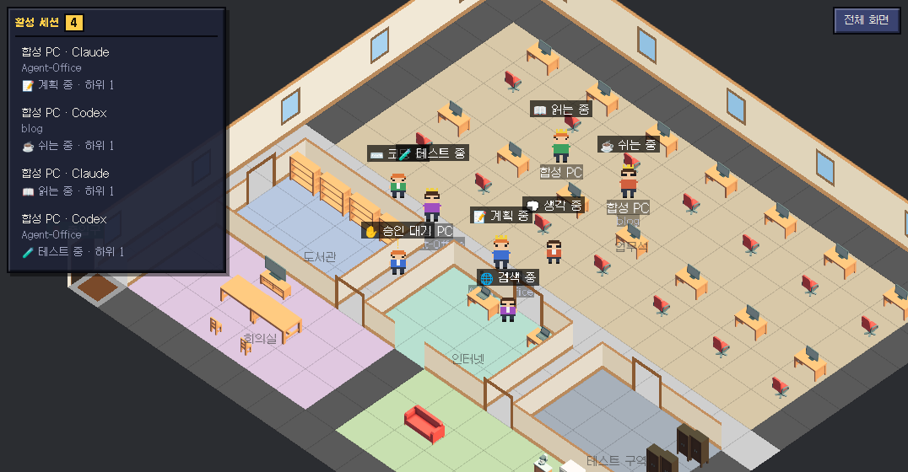

<p align="center">
  
</p>

<h1 align="center">🏢 Agent Office</h1>

<p align="center">
  <b>내 AI 코딩 에이전트들이 출근하는 픽셀 사무실</b><br>
  여러 PC의 Claude Code·Codex 세션이 작은 캐릭터가 되어, 하는 일에 따라 사무실을 돌아다닙니다.
</p>

<p align="center">
  <a href="https://github.com/apg0001/Agent-Office/releases"></a>
  
  <a href="https://github.com/apg0001/Agent-Office/actions/workflows/ci.yml"></a>
  
  
</p>

<p align="center">
  <a href="#-주요-기능">주요 기능</a> ·
  <a href="#-빠른-시작">빠른 시작</a> ·
  <a href="#-지원-범위">지원 범위</a> ·
  <a href="#-문서">문서</a> ·
  <a href="#-기여와-라이선스">기여</a>
</p>

---

## 🧭 소개

Agent Office는 여러 컴퓨터에서 돌아가는 AI 코딩 에이전트(Claude Code, Codex)의 **활동 상태**를 아이소메트릭 픽셀 사무실로 보여 주는 셀프 호스팅 서비스입니다. 각 PC에 설치한 Collector가 Hook으로 "지금 무엇을 하는 중인지"만 서버에 보내면, 에이전트 캐릭터가 파일을 읽을 땐 도서관으로, 테스트를 돌릴 땐 테스트 구역으로, 턴이 끝나면 휴게실로 걸어갑니다. 혼자 쓰는 개인 사무실뿐 아니라 팀원끼리 함께 보는 팀·통합 사무실도 있습니다.

> [!NOTE]
> 현재 **0.1.0-beta.5**(2026-10-28)입니다. Stable 릴리스는 아직 없으며, 아래 [지원 범위](#-지원-범위)에 적은 것만 실제로 검증했습니다.

## 🗺️ 사무실 구역

캐릭터가 어디에 있는지 보면 무엇을 하는지 알 수 있습니다.

| 구역 | 여기 있으면 |
|---|---|
| 🖥️ **업무석** | 자기 자리. 코드 편집·생각 중·승인 대기·하위 에이전트 위임·결과 정리 |
| 📚 **도서관** | 파일 읽기·코드 검색 |
| 🌐 **인터넷** | 웹 검색·웹 페이지 가져오기 |
| 🗂️ **회의실** | 계획 세우기(할 일 목록·계획 도구) |
| 🧪 **테스트 구역** | 테스트 실행 |
| 🛋️ **휴게실** | 할 일 없이 쉬는 중(턴이 끝남) |
| 🚪 **출입구** | 세션이 시작되면 들어오고, 끝나면 여기로 퇴근 |

### 💬 머리 위 상태

캐릭터 머리 위에는 지금 상태가 작은 말풍선으로 뜹니다. 내용(프롬프트·코드)은 없고 상태만 보입니다.

`📖 읽는 중` `⌨️ 코딩 중` `🧪 테스트 중` `🌐 검색 중` `📝 계획 중` `📨 위임 중` `📋 보고 중` `💭 생각 중` `✋ 승인 대기` `☕ 쉬는 중`

## ✨ 주요 기능

- **실시간 사무실** — 세션이 시작·종료되고 활동이 바뀌면 WebSocket으로 바로 반영되고, 캐릭터가 해당 구역으로 이동합니다.
- **머리 위 상태와 활성 세션 목록** — 화면 왼쪽 목록에서 PC·도구·작업 폴더 이름·하위 에이전트 수를 보고, 고르면 그 캐릭터에 초점이 갑니다.
- **팀·통합 사무실** — 팀원들의 에이전트를 한 사무실에서 봅니다. 팀원마다 **모두 공유 / 선택한 프로젝트만 / 공유 안 함** 중에서 공유 범위를 직접 고릅니다.
- **전체 화면** — 버튼 하나로 사무실만 크게 띄워 모니터에 걸어 둘 수 있습니다.
- **Collector 데스크톱 앱** — Windows·macOS·Linux 설치 파일, 트레이 아이콘, 설치 직후 설정 마법사, 사용자가 승인해야 설치되는 자동 업데이트.
- **셀프 호스팅 운영** — Docker Compose와 Caddy 단일 진입점, 설치 마법사, 백업·복원, 승인형 업그레이드·롤백(`deploy/upgrade.sh`), 알림.

### 🔒 개인정보 원칙

- 프롬프트, 소스 코드, 파일 본문, 도구 입출력, 전체 명령, 로컬 경로는 **서버로 보내지 않습니다.**
- 서버가 받는 것은 상태 enum(예: `reading`, `testing`)과 세션·장치 ID 같은 메타데이터뿐입니다.
- 작업 폴더 **이름**(전체 경로 아님)은 세션 구분용으로 기본 전송되며, PC별로 끌 수 있습니다(`agent-office-collector settings workspace-name off`).
- Hook은 fail-open·짧은 타임아웃·비차단이며, 기존 Claude/Codex 설정을 덮어쓰지 않습니다.

## 🚀 빠른 시작

### 1. 서버 띄우기

Docker Compose가 있는 호스트에서 공식 이미지(GHCR) 또는 소스 빌드로 설치합니다.

```sh
cp deploy/.env.production.example deploy/.env.production   # 값 채우기
C="docker compose --env-file deploy/.env.production -f deploy/compose.production.yaml"
$C up -d --wait
$C exec server alembic -c /app/alembic.ini upgrade head
$C exec server agent-office-bootstrap      # 일회용 토큰 → 브라우저에서 /setup
```

자세한 절차는 [설치 방식](docs/installation/install-methods.md), [배포·롤백](docs/operations/deploy.md), [원격 접속](docs/installation/remote-access.md)을 보세요.

### 2. 각 PC에 Collector 설치

[Releases](https://github.com/apg0001/Agent-Office/releases)에서 OS에 맞는 설치 파일을 받습니다. 로그인한 뒤 메인 화면의 설치 안내에도 OS별 링크와 서버 주소가 나옵니다.

| OS | 설치 |
|---|---|
| 🪟 Windows | `.exe` 설치 프로그램 실행 |
| 🍎 macOS | `.pkg` 설치 |
| 🐧 Linux(Ubuntu 22.04 이상) | `sudo apt install ./agent-office-collector_*.deb ./agent-office-collector-desktop_*.deb` |

설치가 끝나면 설정 마법사가 열립니다. 브라우저로 로그인해 PC를 등록하고 Hook 설치에 동의하면 사무실에 캐릭터가 나타납니다.

> [!WARNING]
> 설치 파일에는 아직 코드 서명·공증이 없습니다. macOS는 "개인정보 보호 및 보안 → 그래도 열기", Windows는 SmartScreen에서 "추가 정보 → 실행"을 눌러야 합니다.

자세한 내용: [Collector GUI](docs/installation/collector-gui.md) · [설치 패키지](docs/installation/collector-packages.md) · [업데이트](docs/installation/collector-update.md) · [CLI](docs/installation/collector-cli.md)

### 개발 환경

Python 3.13+, Node.js 24+, npm 11+, Go 1.24+, Docker Compose가 필요합니다. [개발 환경 문서](docs/installation/development.md)와 [CONTRIBUTING.md](CONTRIBUTING.md)의 제출 전 확인 명령을 따르세요.

## ✅ 지원 범위

**Beta**입니다. 검증하지 않은 조합은 지원한다고 하지 않습니다. 0.1.0-beta.5 기준 근거는 [릴리스 노트](docs/releases/0.1.0-beta.5.md)와 [호환성 행렬](docs/compatibility/matrix.md)에 있습니다.

| 항목 | 상태 |
|---|---|
| 서버·웹 | CI(`CI Gate`, 브라우저 E2E)와 운영 Raspberry Pi에서 72시간 실행 검증 |
| Collector 설치 파일 | GitHub Actions Windows·macOS·Ubuntu 22.04·24.04(amd64·arm64) 러너 설치 시험 |
| Linux 데스크톱 설치 | Ubuntu 22.04 실제 PC에서 두 deb 함께 설치 확인 |
| Claude Code | Linux arm64에서 Hook 이벤트 부분 실측. Windows·macOS 미실측 |
| Codex | CLI(Windows·Linux)·Desktop(Windows) 부분 실측. macOS·Windows 사용자 범위 Hook 미검증 |
| 미검증 | 사람이 직접 누르는 macOS GUI 흐름, 데스크톱 트레이 표시·클릭, rpm 설치, Windows arm64, Debian 12 데스크톱 패키지 |

## 🧱 구조

```text
apps/server/             🐍 FastAPI REST/WebSocket, 인증·권한·상태 엔진 (Python)
apps/web/                🎨 React + TypeScript 설정 UI, Phaser 사무실 렌더러
collector/core/          ⚙️ Go 백그라운드 수집·정규화·큐·전송
collector/gui/           🖱️ Go(Wails) 데스크톱 앱·트레이
collector/adapters/      🔌 제공자별 검증된 입력 어댑터
collector/packaging/     📦 OS별 설치 파일 빌드
packages/event-schema/   📜 서버·Collector 공통 버전형 이벤트 계약과 합성 fixture
deploy/                  🐳 개발·운영 Compose, Caddy, 업그레이드 스크립트
docs/                    📚 아키텍처, 설치, 운영, 호환성, 의사결정(ADR)
```

## 📚 문서

| 분류 | 문서 |
|---|---|
| 시작 | [문서 목차](docs/README.md) · [프로젝트 상태](docs/project-status.md) · [변경 기록](CHANGELOG.md) · [릴리스 노트](docs/releases/0.1.0-beta.5.md) |
| 설치 | [설치 방식](docs/installation/install-methods.md) · [Docker 이미지](docs/installation/docker-images.md) · [원격 접속](docs/installation/remote-access.md) · [Collector GUI](docs/installation/collector-gui.md) |
| 운영 | [배포·롤백](docs/operations/deploy.md) · [백업·복원](docs/operations/backup-restore.md) · [모니터링](docs/operations/monitoring.md) · [알림](docs/operations/notifications.md) · [런북](docs/operations/runbook.md) |
| 설계 | [아키텍처 개요](docs/architecture/overview.md) · [상태 엔진](docs/architecture/state-engine.md) · [사무실 렌더러](docs/architecture/office-renderer.md) · [API](docs/api/README.md) · [ADR](docs/decisions/) |
| 보안 | [보안 정책](SECURITY.md) · [위협 시나리오](docs/security/threat-scenarios.md) |

## 🤝 기여와 라이선스

- 작업 목록: [GitHub Issues](https://github.com/apg0001/Agent-Office/issues)
- 기여 절차: [CONTRIBUTING.md](CONTRIBUTING.md) (Issue → `develop`에서 브랜치 → PR)
- 보안 문제 제보: [SECURITY.md](SECURITY.md)

라이선스는 저장소 소유자의 결정 전까지 **미정**입니다. 라이선스가 확정되기 전에는 재배포 조건을 추정하지 마세요.

<p align="center"><sub>🧑‍💻 오늘도 에이전트들은 출근 중입니다.</sub></p>
