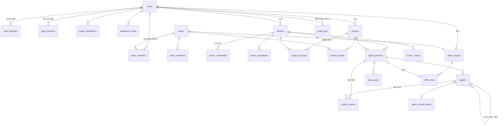

# 데이터 모델과 마이그레이션

관련 이슈: #22

스키마의 단일 소스는 [`apps/server/src/agent_office/db/schema.py`](../../apps/server/src/agent_office/db/schema.py)이고, 초기 마이그레이션은 `apps/server/src/agent_office/db/migrations/versions/0001_initial_schema.py`입니다. 테스트가 마이그레이션 결과와 메타데이터의 차이가 0인지 확인합니다.

## ERD



실시간 전달(#37)을 위해 마이그레이션 `0003`이 전역 시퀀스 `state_change_seq`와 `agent_sessions.change_seq·changed_at`, `agent_current_states.change_seq`를 추가했습니다. 화면에 보이는 값이 바뀔 때만 증가합니다. 마이그레이션 `0004`는 현재 활동의 관측·추정 구분 `agent_current_states.confidence`를 추가했습니다(#47). 마이그레이션 `0008`은 세션 작업 폴더 이름 `agent_sessions.workspace_name`을 추가했습니다(#181).

`instance_settings`와 `notification_channels`는 인스턴스 전역 테이블입니다. 마스터 사양의 `schema_migrations`는 Alembic의 `alembic_version` 테이블이 맡습니다.

## 무결성 규칙

| 규칙 | 구현 |
|---|---|
| 이메일 고유·정규화 | `users.email` 고유 인덱스 + 소문자·`@` 검사 |
| 인스턴스 역할과 팀 역할 분리 | `users.instance_role`과 `team_members.role`을 별도 컬럼·별도 검사로 저장 |
| 마지막 활성 SUPER_ADMIN 보호 | `trg_users_guard_last_super_admin`: 삭제·강등·비활성화를 거부. advisory lock으로 동시 강등 경쟁 직렬화 |
| 팀 OWNER 정확히 1명 | 최대 1명: 부분 고유 인덱스. 최소 1명: 커밋 시점 지연 제약 트리거. 같은 트랜잭션에서 강등→승격으로 소유권 이전 |
| 사용자-팀 관계 고유 | `team_members` PK `(team_id, user_id)` |
| 열린 초대 중복 방지 | `(team_id, email)` 부분 고유(수락·철회 전) |
| 토큰 원문 미저장 | 세션·인증·초대·장치 토큰과 장치 등록 코드(`device_registration_codes`, #26)는 SHA-256 해시(`bytea(32)`)만 고유 저장 |
| 일회용 토큰 | `consumed_at` 기록 후 재사용 금지(검증은 서비스 계층, 시간 순서는 DB 검사) |
| 장치 이름 | 사용자별 활성 장치 이름 대소문자 무시 고유 |
| 세션 식별자 충돌 방지 | 이벤트의 `session_id`는 `agent_sessions.collector_session_id`로 저장하고 `(device_id, provider, collector_session_id)` 고유. 서버 PK와 분리 |
| 이벤트 장치 일치 | `activity_events (session_id, device_id)` → `agent_sessions (id, device_id)` 복합 FK. 다른 장치가 남의 세션에 이벤트를 넣을 수 없음 |
| 이벤트 멱등성 | `activity_events.event_id` PK. 수집은 `ON CONFLICT DO NOTHING`. 내용 충돌은 `payload_digest` 비교로 판정(#35) |
| 부모·자식 에이전트 | `(session_id, parent_agent_id)` → `(session_id, id)` 복합 FK, 자기 참조 금지, `lead` ⇔ 부모 없음 |
| 관측·추정 구분 | `source = 'inferred'`면 `confidence = 'inferred'` |
| 책상 배정 | 레이아웃당 슬롯 번호·좌표 고유, 세션은 레이아웃당 책상 1개 |
| 프로젝트 공유 | `(project_id, team_id)` PK. 한 프로젝트를 여러 팀에 공유해도 이벤트는 한 번만 저장 |

부모 에이전트 순환(A→B→A)은 FK로 막을 수 없습니다. 수집 API(#35)가 부모가 먼저 존재하는지 확인하고, 부모를 나중에 바꾸지 않습니다.

## 원문을 저장하지 않는 설계

- 자유 형식 `TEXT` 컬럼이 없습니다. 모든 문자열은 길이 상한(최대 500)이 있고, `prompt`·`command`·`content`·`path`·`output`·`transcript`·`message` 같은 이름의 컬럼이 없음을 테스트로 확인합니다.
- `activity_events` 컬럼은 이벤트 v1 허용 필드와 서버 전용 `received_at`·`payload_digest`뿐입니다.
- `plan_steps`는 순서와 상태만 저장하고 계획 문장은 저장하지 않습니다.
- `agent_sessions.workspace_name`(마이그레이션 `0008`, #181)은 사용자가 PC별로 켠 경우의 작업 폴더 **마지막 이름**만 담습니다(`varchar(64)`, NULL 허용). `ck_agent_sessions_workspace_name`이 1~64자와 `/`·`\`·제어 문자 없음을 강제합니다. 전체 경로·상위 폴더는 저장하지 않습니다.
- `project_sources`는 Collector가 만든 장치별 HMAC 지문만 저장합니다. 경로·원격 URL은 저장하지 않습니다.
- `notification_channels`의 Webhook URL·토큰·SMTP 암호는 `secret_ciphertext`에 암호화해 둡니다(암호화 키 관리는 #67·#70). `instance_settings`에는 비밀을 두지 않습니다. 인스턴스 비밀(SMTP 암호, OAuth client secret)은 `instance_secrets`에 AES-256-GCM 암호문으로 둡니다(#67, 마이그레이션 `0005`).
- `audit_logs.details`는 허용 목록 키만 담는 요약입니다(#28).

## 보존·삭제

| 대상 | 기준 | 인덱스 |
|---|---|---|
| 활동 이벤트 30일 | 서버 수신 시각 `received_at`(클라이언트 시각은 위조 가능) | `ix_activity_events_received_at` |
| 종료 세션 30일 | `agent_sessions.ended_at` | 부분 인덱스 `ended_at IS NOT NULL` |
| 하트비트 | `device_heartbeats.received_at` | `ix_device_heartbeats_received_at` |
| 만료 토큰 | `expires_at` | 테이블별 인덱스 |

삭제 연쇄:

- 사용자 삭제 → 인증 식별자·세션·토큰·장치·프로젝트·소속·개인 레이아웃 삭제. 장치 삭제는 세션·에이전트·이벤트·커서까지 연쇄 삭제합니다.
- 사용자가 팀 OWNER이면 삭제가 커밋 시점에 거부됩니다. 소유권을 먼저 이전하거나 팀을 삭제해야 합니다.
- 마지막 활성 SUPER_ADMIN은 삭제할 수 없습니다.
- 감사 로그는 남기고 행위자 참조만 `NULL`로 바꿉니다. 감사 로그 자체의 보존 기간은 #28에서 정합니다.
- 활성 세션의 현재 상태(`agent_current_states`)는 세션이 끝날 때까지 유지되고 보존 삭제 대상이 아닙니다.

대량 이벤트 보존 삭제는 처음에는 인덱스 기반 배치 `DELETE`로 시작합니다. Pi 실측(#63)에서 부하가 크면 `received_at` 월별 파티셔닝을 ADR로 검토합니다.

## 마이그레이션 실행과 롤백

```bash
# 서버 이미지 안에서
alembic -c /app/alembic.ini upgrade head
alembic -c /app/alembic.ini current
```

- 연결 URL은 `AGENT_OFFICE_DATABASE_URL`(`postgresql+psycopg://...`)로만 받습니다. Compose가 PostgreSQL 변수로 조합합니다.
- 리비전마다 별도 트랜잭션으로 실행하므로, 실패한 리비전은 통째로 되돌아갑니다.
- `downgrade`는 개발·검증용입니다. 데이터가 있는 운영 DB에서 `0001` downgrade는 모든 테이블을 삭제하므로 **사용하지 않습니다.** 운영 롤백은 배포 전 자동 백업(#58)에서 복원하는 것을 원칙으로 합니다.
- 이후 리비전은 역호환을 기본으로 합니다(컬럼 추가 → 코드 배포 → 이전 컬럼 제거를 별도 릴리스로). 역호환되지 않는 변경은 PR에 복원 계획을 함께 적고 관리자 승인을 받습니다(#60).
- 새 리비전 생성: `cd apps/server && PYTHONPATH=src alembic revision --autogenerate -m "<설명>"` 후 생성 파일을 반드시 검토합니다. 트리거·함수는 autogenerate가 만들지 않습니다.

## 검증

`apps/server/tests/test_db_schema.py`는 `AGENT_OFFICE_TEST_DATABASE_URL`이 있으면 임시 DB를 만들어 다음을 확인합니다. CI는 PostgreSQL 17.11 서비스로 항상 실행합니다(`AGENT_OFFICE_REQUIRE_DB_TESTS=1`이면 건너뛰지 않고 실패).

- 마이그레이션 head와 메타데이터 차이 0
- downgrade base 후 테이블·함수 0, 재-upgrade
- 이메일 정규화·고유, 마지막 SUPER_ADMIN 보호, 팀 OWNER 정확히 1명과 소유권 이전
- 이벤트 멱등(3회 재전송 1건), 다른 장치 이벤트 거부, 추정 소스의 observed 거부
- 에이전트 계층의 같은 세션 제한, 책상 중복 배정 거부
